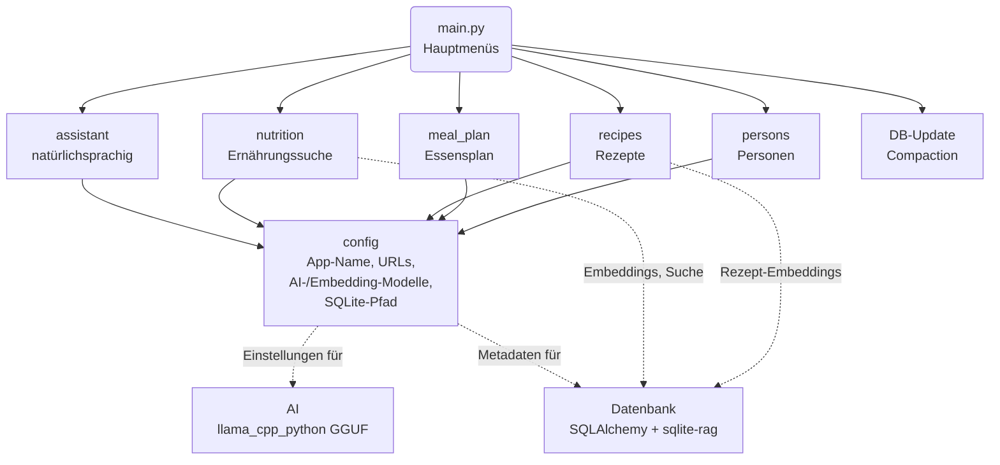

# Projektübersicht

| Name   | Value      |
| :----- | :--------- |
| Status | ~Published |
| Owner  | @iBrotNano |

## Motivation

Dies ist ein einfaches Trainingsprojekt für einen Python-Workshop. Es demonstriert,
wie man eine KI-gestützte Konsolenanwendung entwickelt, die Ernährungsdaten aus
[world.openfoodfacts.org](https://world.openfoodfacts.org/) verwendet, um Rezepte,
Essenspläne und Einkaufslisten für ein Haushalt zu erstellen.

## Zweck

Das Projekt baut einen KI-gestützten **Ernährungsassistenten** ("fat_cat" / "Fezzikazza"):
eine Konsoleanwendung, die über `python .\src\main.py` gestartet wird. Sie ermöglicht
es, anhand persönlicher Daten und gespeicherter Rezeptdaten eine individuelle
Ernährung und Essensplanung zu erstellen.

## Architektur

Die Anwendung ist in modularisierte Bereiche unterteilt, die jeweils einen
Aufgabengebiet des Systems abbilden.

## Module

| Modul | Beschreibung |
| :---- | :----------- |
| `src/main.py` | Haupteinstiegspunkt; zeigt die Hauptmenüs (Assistent, Ernährungssuche, Rezepte, Essensplan, Personen, DB-Update/Compaction). |
| `src/nutrition/` | `Nutrition` (Dataclass mit ca. 90 Nährstofffeldern pro 100 g) und `NutritionEntity` (SQLAlchemy-Entität, Tabelle `nutrition`). |
| `src/recipes/recipe.py` | `Recipe` (Zutaten, Anleitung, Nährwerte) mit Berechnung der Rezeptnährwerte. |
| `src/persons/` | `Person` mit Kalorienberechnung über die **Mifflin-St Jeor-Formel**, sowie die Auf-enumerierten Typen `ActivityLevel` und `Gender`. |
| `src/meal_plan/meal_plan.py` | `MealPlan` (7 Tage × 5 Mahlzeiten) mit Zuweisung und Abgleich von Rezepten. |
| `src/assistant/command_line_handler.py` | Konsole-Handler des Assistenten (natürlichsprachige Abfrage, fortlaufendes Gespräch). |
| `src/config/configuration.py` | Config-Dataclass (App-Name, Download-URLs, AI-/Embedding-Modelle, SQLite-Pfad). |

## Technologie

| Bereich | Einsatz |
| :------- | :------ |
| Persistenz | SQLAlchemy (SQLite) mit **`sqlite-rag`** für Embedding-/Suchfunktionalität. |
| KI | lokale **GGUF-Modelle** über `llama_cpp_python`. |
| Datenverarbeitung | `pandas`. |
| Dokumente | `python-docx`. |

## Daten und Tests

> [!TIP]
> Testdaten können erzeugt werden, indem `tools/create_test_recipes.py` ausgeführt wird.
> Es werden Rezepte unter `data` erzeugt.

## Verwandte Artikel

- [Datamodel And Persistence](persistence.md) enthält alle Informationen, die benötigt werden,
  um mit der Datenbank zu arbeiten und neue Entitäten in das System aufzunehmen.
