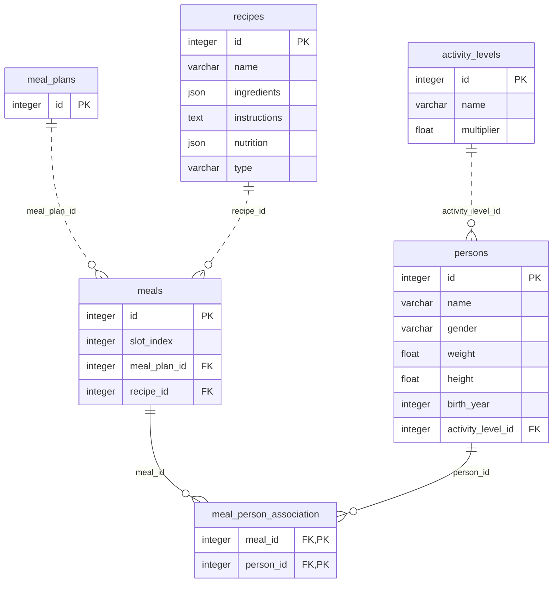

# Datamodel And Persistence

| Name   | Value      |
| :----- | :--------- |
| Status | ~Published |
| Owner  | @iBrotNano |

## Motivation

Developers who want to know about the data model of the app will find the needed information here.

## Datamodel

The app stores persons, recipes, meals and meal plans. Persons are persons in a household and used to calculate the needed nutrition. Recipes are containers for food and are used in meal plans to calculate the nutrition for meals. A meal plan ist a collection for meals for a household.



## Adding new entities

If you need to add a new entity class to store data into the database it must be registered to ensure they are known by sqlalchemy. It can be registered in `persistence/model_registry.py`.

```py
def load_model_definitions():
    """
    Imports ORM model modules so SQLAlchemy metadata knows all table mappings.

    :raises ModuleNotFoundError: If a model module cannot be imported.
    """
    import_module("persistence.schema")
    import_module("meal_plan.meal_plan_entity")
    import_module("meal_plan.meal_entity")
	...
```

## Unity Of Work

All data access logic is encapsulated in a `unit_of_work.py`. It initializes the database session and all repositories. It handles commits, rollbacks when failures happens and frees resources like the session.

It can be used with `with`.

```py
with UnitOfWork() as uow:
    self._meal_plan = uow.meal_plans.get() or MealPlan()
```

## Database maintenance

After creating and quantizing embeddings, select **Compact the database** from the
main menu when you want to reclaim space. Compaction is optional and is never run
automatically. The prompt shows the database size and bytes on completely free
pages; even with no free pages, partially filled pages may be repacked, so this
number is not an exact prediction of the savings.

Back up the database and close other application instances and tools before
compacting. SQLite needs exclusive access and may require up to twice the
database size in additional disk space. The command creates a compacted copy
beside the original and verifies sentence row IDs before replacing it, because
the vector index refers to those IDs. If verification or compaction fails before
replacement, the original is left in place and the error is displayed. The command currently
requires SQLite's `DELETE` journal mode; it refuses databases in WAL mode.

Nutrition search reuses its retriever while the application is open and closes it
before an update, compaction, or shutdown. With sqlite-rag 0.1.4, sentence
highlights are calculated in a single vector scan for each group of search
results. Other sqlite-rag versions use the library's original search method.
Search time still depends on the number of vectors, storage, and available
memory; compaction alone is not a guarantee of faster searches.

For performance comparisons, use a read-only database connection or a separate
copy. Initialize the embedding model once, then time repeated representative
queries including nutrition-record lookup, separately from first-use model
initialization and interactive selection. Record `top_k`, result counts, and
individual timings, and compare ranked results and sentence highlights with
the original search.